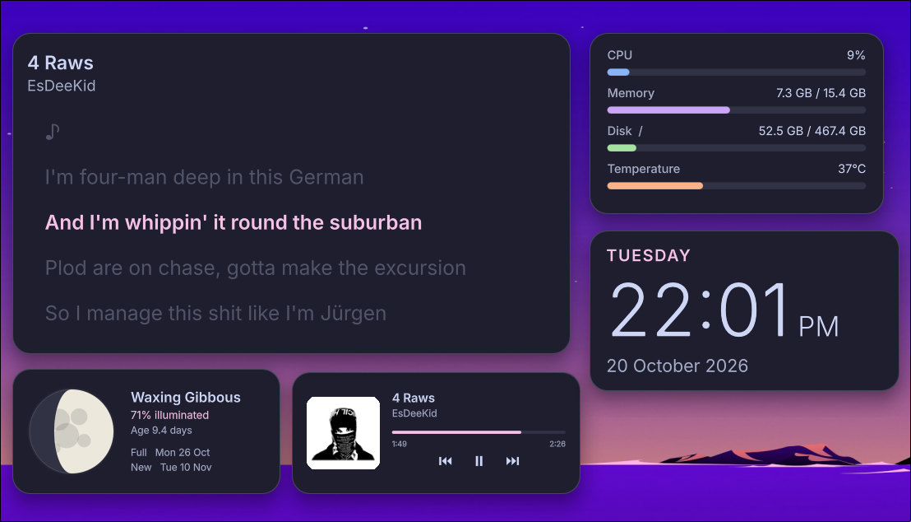
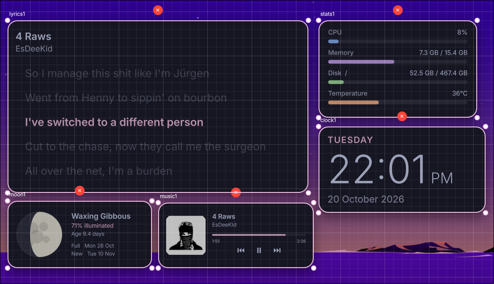

# rosewidgets
A (cool) desktop widgets shell.




## features

- clock, music (mpris), calendar, system stats, weather, wi-fi + bluetooth
- live edit mode: drag, resize, add and remove widgets with the mouse
- grid lines and magnets (snap to other widgets, screen edges and center)
- auto-tile: stack widgets neatly in a screen corner, sized by their real content
- themes and custom QML widgets
- config reloads live on save

## requirements

- **linux + wayland** — rosewidgets is intended for wayland desktops (needs layer-shell support).
- **[quickshell](https://github.com/quickshell-mirror/quickshell)** — required to run the widgets.
- **a compatible wayland compositor** — (MangoWM used for testing)
- **coreutils** — used by the installer for file operations.
- **Inter font** — default font, any other can be set in a theme.

some widgets need extra tools, install only what you use:

| widget | needs |
| --- | --- |
| music | any mpris player |
| weather | `curl` + internet (wttr.in) |
| network | NetworkManager (`nmcli`), BlueZ (`bluetoothctl`) |
| stats | none |
| clock, calendar | none |

## installation

clone the repository and run the installer:

```bash
git clone https://github.com/sappyware/rosewidgets.git
cd rosewidgets
chmod +x install.sh
./install.sh
```

the installer copies the QML files into `~/.config/quickshell/rosewidgets/` and creates `~/.config/rosewidgets/` with a default `config.toml` (an existing one is never overwritten).

## running

start rosewidgets with:

```bash
qs -c rosewidgets
```

to stop it, use:

```bash
qs -c rosewidgets kill
```
example usage in MangoWM:
```bash
exec_once=qs -c rosewidgets
```
and
```bash
bind=SUPER,e,spawn,qs -c rosewidgets ipc call rosewidgets toggleEdit
```

### ipc

```bash
qs -c rosewidgets ipc call rosewidgets toggleEdit   # enter / leave edit mode
qs -c rosewidgets ipc call rosewidgets setEdit true # or false
qs -c rosewidgets ipc call rosewidgets reload       # restart the shell
```

## edit mode

- **drag** a widget to move it, drag its corners or edges to resize
- **double-click** a widget to reset it to its natural size
- **+ Add widget** opens a panel to add widgets and switch theme
- **✕** above a widget removes it
- **Snap** toggles magnets, hold **Alt** while dragging to bypass them once
- **Auto-tile** toggles auto-tiling, then drag a widget onto another to move it there
- **Esc** or **Done** to leave

positions, sizes and tile order are written back to `config.toml` automatically.

## configuration
config file is located at ```~/.config/rosewidgets/config.toml```
```toml
[general]
theme = "catppuccin-mocha-pink"   # file name in ~/.config/rosewidgets/themes/<name>.toml
monitor = ""                      # output name (e.g. "DP-1"), empty = first monitor
grid = 20                         # edit-mode grid spacing in px

# auto-tile: stack widgets in a screen corner
autotile = false
tile_corner = "bottom-right"      # bottom-right | bottom-left | top-right | top-left
tile_gap = 20                     # px between widgets
tile_margin = 24                  # px from screen edges
# tile_order = ["clock1", "music1", "stats1"]   # first = in the corner (set by dragging in edit mode)


# widgets: [widgets.<id>] where <id> is any unique name
# common keys (all optional except type):
#   type    = widget type (see below)
#   x, y    = position in px (ignored when autotile = true)
#   width, height = size in px, 0/omitted = natural size

[widgets.clock1]
type = "clock"
x = 60
y = 60
hour24 = false                    # true = 24h time
show_seconds = false
show_date = true

[widgets.music1]
type = "music"                    # now playing (MPRIS), no options
x = 60
y = 250

[widgets.calendar1]
type = "calendar"
x = 60
y = 440
week_start = "monday"             # monday | sunday

[widgets.stats1]
type = "stats"                    # CPU, RAM, disk, temp
x = 420
y = 60
units = "metric"                  # metric | imperial (temperature)

[widgets.weather1]
type = "weather"                  # needs curl + internet (wttr.in)
x = 420
y = 260
location = ""                     # e.g. "Berlin", empty = auto by IP
units = "metric"                  # metric | imperial

[widgets.network1]
type = "network"                  # Wi-Fi + Bluetooth toggles, no options
x = 420
y = 480
# width = 300
# height = 140

# custom widget: put MyWidget.qml in ~/.config/rosewidgets/widgets/
# [widgets.custom1]
# type = "MyWidget"               # file name without .qml
# x = 800
# y = 60
# anything_else = "value"         # extra keys are passed to the widget as `options`
```

you can have several widgets of the same type, just give each its own id (`[widgets.clock2]`).

### auto-tile

with `autotile = true` the first widget sits in the chosen corner and the rest stack away from it, then sideways in new columns. every column is as wide as its widest content. widgets that reflow (music, stats, network, weather, calendar) fill the column width, the others are scaled up to fit (max 1.25x, then a new column starts). manual `x`, `y`, `width` and `height` are ignored while it is on and kept for when it is off.

## themes

a theme is a file in `~/.config/rosewidgets/themes/<name>.toml`, select it with `theme = "<name>"` or from the edit mode panel. every key is optional, missing ones fall back to catppuccin mocha (pink).

```toml
bg = "#1e1e2e"
surface = "#313244"
border = "#45475a"
text = "#cdd6f4"
subtext = "#a6adc8"
accent = "#f5c2e7"
accent_fg = "#11111b"   # text on accent
green = "#a6e3a1"
yellow = "#f9e2af"
red = "#f38ba8"
blue = "#89b4fa"
purple = "#cba6f7"
peach = "#fab387"
teal = "#94e2d5"
shadow = "#80000000"
radius = 22             # card corner radius
font = "Inter"
```

## custom widgets

drop a QML file in `~/.config/rosewidgets/widgets/` and use its file name as `type`.

```qml
import QtQuick

Item {
  property var theme: ({})     // current theme
  property var options: ({})   // the widget's keys from config.toml
  property bool fluid: true    // layout adapts to any width (optional, used by auto-tile)

  implicitWidth: 200
  implicitHeight: 60

  Text {
    text: options.label || "hello"
    color: theme.text
    font.family: theme.font
  }
}
```

the card, padding, shadow and background are drawn for you. content is scaled to fit when the card is resized, unless you set `property bool responsive: true` to get the real size instead.

## help me fix any bugs with PRs!
